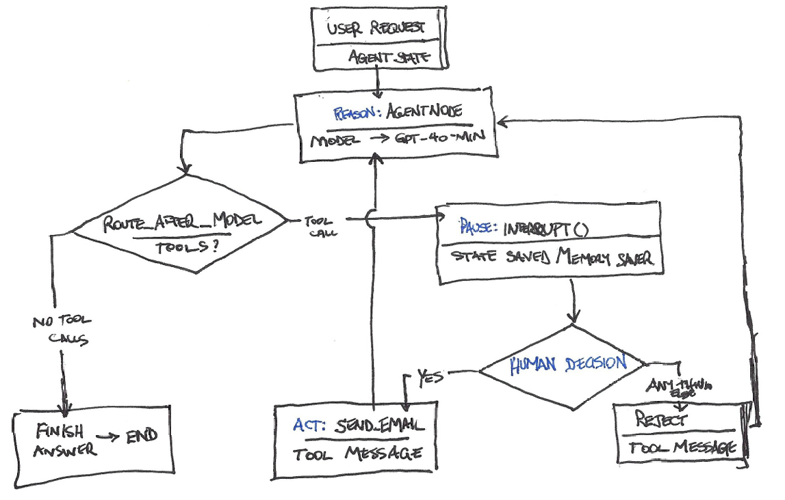

# Human-in-the-Loop 

This document maps each activity of the human-in-the-loop (HITL) pattern to the code in `hitl.py`. The file is a LangGraph agent that drafts an email from a request ("Email alice@example.com saying the report is ready.") and pauses for a human to approve or reject the `send_email` tool call before it runs.

The agent is still a ReAct-style loop (reason → act → observe). The difference is that the **Act** step is replaced by an **approval gate**: the graph saves its state, stops, hands the proposed action to a person, and continues only once it gets their answer.

**Legend:** Reason = model thinking · Human gate = pause and decision · Act / Reject = what goes back to the model as the observation · Control flow = entry, routing, and exit.

## What each activity does in the code

| HITL activity | Code | What happens |
|---|---|---|
| **Sensitive tool** | `@tool send_email(recipient, body)` | The action that needs review. Here it's a stub that returns a string. In production it would actually send the email. |
| **State** | `State` with `messages: Annotated[..., add_messages]` | One message list that collects the request, the model's tool call, the outcome, and the final reply. |
| **Reason** | `call_model` (node `"agent"`), `llm = ChatOpenAI(...).bind_tools([send_email])` | The model reads the messages and either proposes a `send_email` call or replies with text. |
| **Route** | `route_after_model` + `add_conditional_edges("agent", ...)` | If the last message has `tool_calls`, go to `"human_approval"`. Otherwise go to `END`. Every tool call is gated. |
| **Pause** | `interrupt({...})` inside `human_approval_node` | Stops the graph and shows the action name, its arguments, and a prompt to the caller. The run's state is saved so it can resume later. |
| **Persist** | `builder.compile(checkpointer=MemorySaver())`, `thread_id: "session-1"` | `interrupt()` requires a checkpointer. `MemorySaver` keeps the paused state in process memory, keyed by `thread_id`. |
| **Surface to human** | Step A: `graph.stream(initial_input, config)` → `event["__interrupt__"]` | The first run streams until the interrupt and prints the pending action. |
| **Human decision** | Step B: `input(...)` → `graph.stream(Command(resume=user_input), config)` | The person's answer is sent back into the same thread. On resume, `human_approval_node` runs again from the top, and this time `interrupt()` returns the answer. |
| **Approve → Act** | `send_email.invoke(tool_call["args"])` → `ToolMessage` | The approved action runs with the exact arguments shown to the reviewer, and the result is recorded as the observation. |
| **Reject** | `ToolMessage(content="Action rejected by human reviewer.")` | Any answer other than `y`/`yes` counts as a rejection. The model is told the action didn't happen. |
| **Continue / Finish** | `add_edge("human_approval", "agent")` → `END` | Control goes back to the model, which confirms the email was sent (or acknowledges the rejection) and ends. |

## How the Alice email request likely runs

1. **Reason:** The model reads the request and proposes `send_email(recipient="alice@example.com", body="The report is ready.")`.
2. **Route:** `route_after_model` sees a tool call and sends control to `human_approval`.
3. **Pause:** `interrupt()` stops the graph and saves its state. Step A prints `[PAUSED] Pending Action: {'action': 'send_email', 'args': {...}, 'prompt': 'Approve this action? (yes/no)'}`.
4. **Human decision:** The script waits at `input()`. The reviewer types `yes`.
5. **Resume:** `Command(resume="yes")` restarts `human_approval_node` from the beginning. `interrupt()` now returns `"yes"` instead of pausing.
6. **Act → Observe:** `send_email` runs and its result becomes a `ToolMessage`.
7. **Reason → END:** The model replies with something like "I've emailed Alice to let her know the report is ready." The graph ends and Step B prints the final response.

If the reviewer types `no`, step 6 records "Action rejected by human reviewer." instead. The model usually reports that the email wasn't sent, but it may also propose a new version, which triggers another approval.

## Problems in the file that match common HITL failure modes

- **Only the first tool call is handled.** `last_message.tool_calls[0]` ignores any other calls. If the model makes parallel calls (for example, emailing two people at once), the others get no `ToolMessage`, and the next model call fails, because OpenAI requires a response for every `tool_call_id`. Loop over all tool calls, interrupting once per call or once for the whole batch.
- **The tool is hard-coded.** The node always runs `send_email.invoke(...)` whatever `tool_call["name"]` says. That works only while there's a single tool. Look up the tool by name, and gate by risk so read-only tools don't need approval.
- **The reviewer can only say yes or no.** There's no way to fix a typo in the body or change the recipient, so a small mistake forces a rejection and a retry. Accept a structured resume value such as `{"decision": "edit", "args": {...}}` and run the edited arguments.
- **Rejections carry no reason, and retries have no limit.** The model only learns "rejected," so it may propose nearly the same email again, and each retry is another approval request. Capture the reviewer's reason in the `ToolMessage` and cap how many approval rounds a thread can have.
- **Answer parsing is fragile.** `decision.lower()` crashes if the resume value isn't a string, and `" yes"` or `"Yes."` count as rejections. The safe default (anything unclear is rejected) is correct, but strip and normalize the input, or use structured values instead of free text.
- **Paused runs don't survive a restart.** `MemorySaver` lives in process memory, so if the process restarts while waiting for a reviewer, the pending approval is gone. Use a durable checkpointer such as `SqliteSaver` or `PostgresSaver`, and generate a unique `thread_id` per request instead of the fixed `"session-1"`.
- **Step B always asks for input.** If the model answers without a tool call, there's no interrupt, but the script still prompts and resumes. Check for a pending interrupt first, for example with `graph.get_state(config).next` or by recording whether `__interrupt__` appeared.
- **The approval request has little context.** The reviewer sees a raw dict with the action and arguments, but not the original request or why the agent chose this action. Include the user's request, a readable preview of the email, and whether the recipient is internal or external.
- **There's no timeout and no record of who approved.** The script waits forever at `input()` and doesn't log who approved what, or when. Add a timeout that defaults to "don't send," and record the reviewer, the decision, the reason, and the exact arguments approved.
- **Code before `interrupt()` runs twice.** On resume, `human_approval_node` starts over from the top. Here that's harmless, because only reads happen before `interrupt()`. Keep it that way: never put side effects such as sending, writing, or charging before the interrupt in a gated node.
- **What the file gets right:** the gate is in the graph rather than in the prompt, so the model can't skip it. The reviewer sees the exact arguments that will run. Unclear answers default to rejection. The model is told the outcome either way.

[Common Failures in Production Environments](./human-in-the-loop-pattern-production-failures.md)