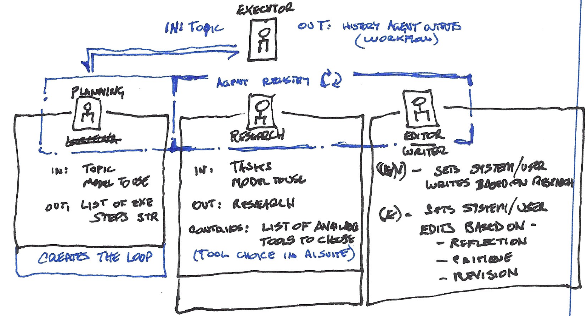

# Planner–Executor architecture
A system design pattern that separates high-level task planning from low-level action execution. A __planner__ breaks a goal into ordered steps or dependencies, while an __executor__ runs each step using tools, APIs, or code and reports results back.

## Executor Pattern
Separates high-level task planning from step-by-step action and tool execution in AI agents. Instead of one model reasoning and acting in an ad-hoc loop at every step, a planner breaks a goal into tasks and an executor carries out the individual actions.  
  
In this case the __executor__ calls the __planning__ __agent__ directly and outside of it's registry of agents to choose from.  It sets the model to use as a task list is returned from planning.  The [AISuite](https://github.com/andrewyng/aisuite) is a lightweight open-source Python library by Andrew Ng that provides a unified interface for calling multiple generative AI and LLM providers—rather than training deep learning models from scratch. This can be replaced as portable usage depending on the Agent Platform.

## 1. Executor sends topic to Planning Agent
Planning agent recieves the topic and uses a specific model with a defined user prompt to provide additional context including model temperature to the LLM about the targeted research workflow for multiple agents, which is returned as a list of tasks.

## 2. Planning Agent returns a list of steps to Executor
Now with a list of research tasks, the Executor decides which task in the list should be performed by which agent.  The step lists are then assigned agents with use of the LLM and a more direct temperature setting can be used.  

## 3. Workflow of assigned tasks are executed by respective Agents
Each agent is provided the context of what has been done it the previous step and executes its assigned task.  The output is generated by the history of the executed tasks.

## Notes: 
* Number of steps can be limited to reduce the size of the workflow.
* Cost and Latency Efficiency are managed with a strong reasoning model for planning with faster, cheaper models for repetitive execution steps.
* Splitting responsibilities adds handoff logic, state management, and risk of mismatch between planned intent and actual tool behavior.
* Tool list can be expanded by modifying the research tools option or integrating an MCP server tool list.
* Planning agent can be modified / included in the agent registry if workflow is updated for re-planning based on reflection critics
* Context window size management, token management and error handling would be required to be added to this example.
