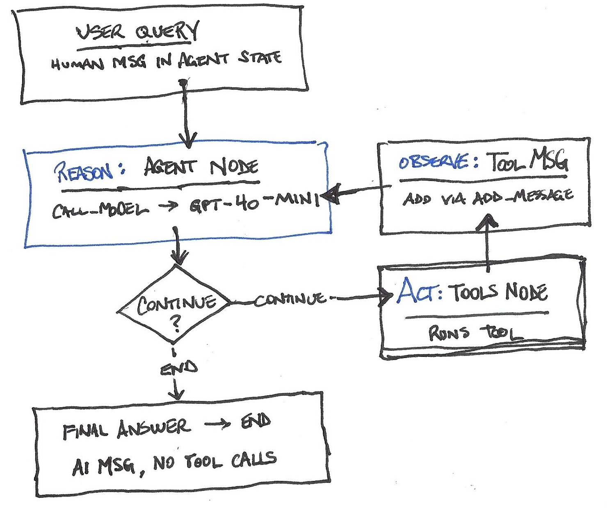

# ReAct 

The ReAct (Reason + Act) pattern in `ReAct_with_Graphs.py`, is a LangGraph agent that answers "What's the weather like in Newark, and what should I wear based on the temperature?" using a Tavily web search tool and a clothing recommendation tool.

## What each activity does in the code

| ReAct activity | Code | What happens |
|---|---|---|
| **Setup** | `tools`, `tools_by_name`, `model.bind_tools(tools)`, `chat_prompt` | `search_tool` and `recommend_clothing` are registered and indexed by name. Binding them tells gpt-4o-mini what it can call. The system prompt adds step-by-step instructions. |
| **State (scratchpad)** | `AgentState` with `messages: Annotated[..., add_messages]` | A single message list. The `add_messages` reducer appends each node's output, so the list acts as the ReAct scratchpad the model re-reads every turn through `MessagesPlaceholder("scratch_pad")`. |
| **Reason** | `call_model` (node `"agent"`) | Sends the full message history to the model. It returns either an `AIMessage` with `tool_calls` (wants to act) or plain text (finished). |
| **Decide** | `should_continue` + `add_conditional_edges` | Checks whether the last message has `tool_calls`. Routes to `"tools"` on `"continue"` or to `END` on `"end"`. |
| **Act** | `tool_node` (node `"tools"`) | Runs every requested tool call by looking it up in `tools_by_name` and invoking it with the model's arguments. |
| **Observe** | `ToolMessage(..., tool_call_id=...)` + `add_edge("tools", "agent")` | Each result is wrapped in a `ToolMessage` linked to its call ID and appended to state. The fixed edge sends control back to Reason. |
| **Finish** | `END` | When the model replies without tool calls, the graph stops and the last `AIMessage` is the answer. |

## How the Newark question likely runs

1. **Reason:** The model reads the question and asks for `search_tool("weather in Newark")`.
2. **Act → Observe:** Tavily results come back as a `ToolMessage`.
3. **Reason:** The model pulls a summary (for example, "Overcast, 48°F") from the results and calls `recommend_clothing`.
4. **Act → Observe:** The tool returns a clothing suggestion.
5. **Reason → END:** With no more tool calls needed, the model writes the final answer and the graph ends.

That's two full loops. The model could request both tools at once, but it can't choose clothing until it knows the temperature, so the calls usually happen one after the other.

## Problems in the file that match common ReAct failure modes

- **No step limit.** `graph.stream(inputs)` relies on LangGraph's default recursion limit, so a looping model fails with an error instead of stopping cleanly. Pass `config={"recursion_limit": 10}` and handle the error.
- **Tool errors crash the graph.** A Tavily timeout, or a tool name the model made up (which raises a `KeyError` in `tools_by_name`), ends the run. Wrap the call in `try/except` and return the error as a `ToolMessage` so the model can recover.
- **`recommend_clothing` matches text, not temperatures.** It checks for substrings like `"85"` and `"50"`, so "48°F" falls through to "light jacket." Pull out the number and compare it against temperature ranges.
- **Raw search results go straight into the context.** Tavily returns several long snippets each time, which the agent has to read through. Trim them to the fields you need before creating the `ToolMessage`.
- **Small issues:**
  - `tool` is imported twice (`langchain_core.tools` and `langchain.tools`). Keep only the first.
  - `json.dumps` on a string result adds extra quotes.
  - The API key placeholder is hard-coded. Load it from the environment instead.
